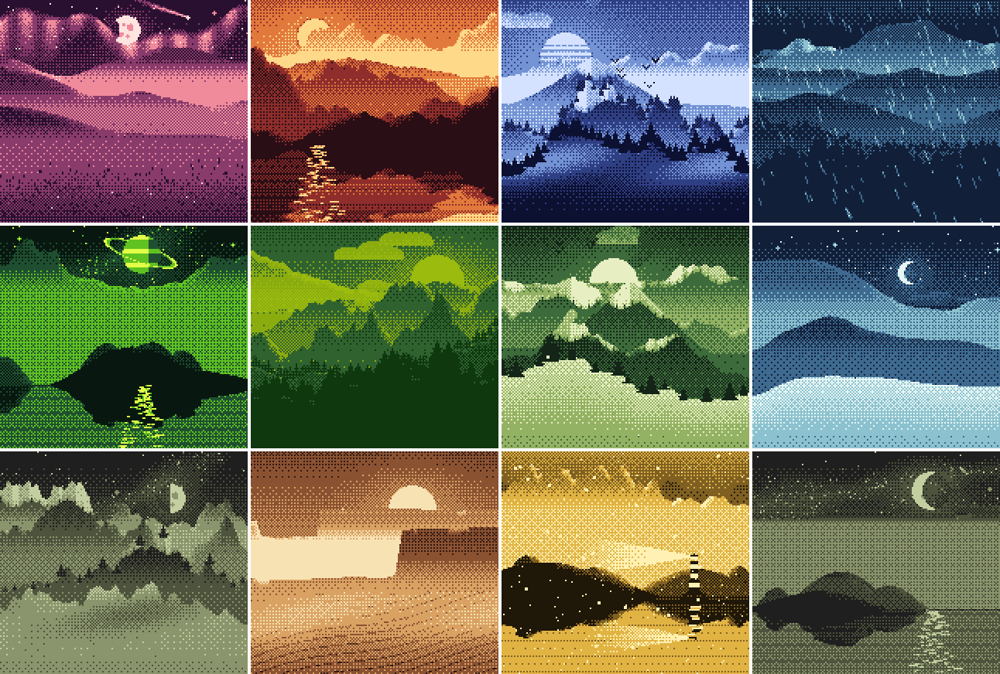
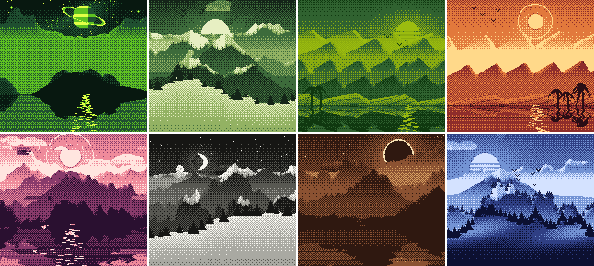

# Slow Horizons

Repo: `gb-seed-lab`.

Generative landscapes drawn by a Game Boy. One seed number decides every trait and every pixel: 160×144, 4 shades, the same picture every time.



**Explorer:** `web/lab/` (runs the ROM's C source in the browser as WebAssembly). Not published while the repo is private.

## How it works

- **One C source** (`gen/`) is built three ways: for the Game Boy ROM (GBDK-2020, `gb/seedlab.gb`), for the web (WebAssembly, `web/gen.wasm`) and natively for tests. The ROM's output matches the native build pixel for pixel (checked in PyBoy on 400 seeds); the WASM build matches native on 2000.
- `gen_traits(seed)` picks the traits first: palette, time of day, sky, terrain, ground, weather, ridge count, snowcaps and extras. `gen_draw(seed)` draws them in a tone field (0 light to 3 dark) with integer maths only, then an 8×8 ordered dither turns it into the 4 Game Boy shades.
- Depth comes from mist: each ridge gets lighter toward its base, far ridges sit near the sky's tone, near ones go dark. Slopes facing the sun or moon get a rim of light.
- The Game Boy only knows shades 0 to 3. The palette is a trait applied when a piece is shown, the way a Game Boy Color colours an original Game Boy game.

Rare traits include eclipse, aurora, twin moons, a ringed planet, comet, lighthouse, cabin and a glitch.



## Live mint (being built)

Each piece is drawn by a real Game Boy at the moment it is bought: the seed is the hash of the payment transaction, the Game Boy draws it phase by phase, the tiles come back over the link cable and are checked against the reference build, then a compressed NFT goes to the buyer. Pay and leave is fine; the page later shows when yours was drawn. Design and the honest limits of "proof of hardware": [`docs/MINT.md`](docs/MINT.md).

- `server/`: payment watcher, queue, the Game Boy lane (no emulator stand-in: no Game Boy, no minting), check, mint (Solana devnet so far).
- `web/index.html`: the mint page (live studio window, queue, finished wall, wallet). Not on GitHub Pages yet; it goes public once its server is reachable.
- Draw time on a DMG: about 1 minute per piece on average (31 s to 2.5 min) plus ~25 s of link transfer, measured in the emulator; real hardware still to measure.

## Run it

```sh
make -C gen                     # native tool + web/gen.wasm
make -C gb                      # Game Boy ROM (needs GBDK-2020)
npm test                        # golden hashes + WASM = native
.venv/bin/python tools/emu.py 1 2 3     # ROM in PyBoy vs native, pixel for pixel
node tools/sheet.js --out sheet.png 1-16
cd server && npm install && DEV=1 MINT=0 node src/index.mjs   # http://localhost:8791
```

## License

Private, all rights reserved (see `LICENSE`). The source and ROM are planned to be published after the mint ends, so anyone can redraw and check every piece.

Game Boy is a trademark of Nintendo. This project is not affiliated with or endorsed by Nintendo.
