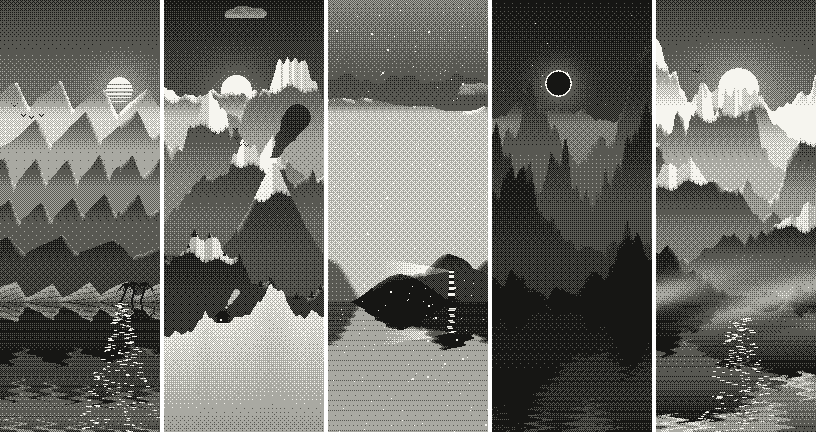

# gb-seed-lab

Generative landscapes drawn by a Game Boy. One seed number decides every trait and every pixel: 160×144, 4 shades, the same picture every time.


**Live preview:** https://hazy2go.github.io/gb-seed-lab/ (runs the generator in your browser)

## How it works

- `traitsFor(seed)` picks the traits first: palette, time of day, sky, terrain, ground, weather, ridge count, snowcaps and extras. Because traits come before drawing, the odds for the whole collection can be counted without rendering anything.
- `landscape(seed)` draws them. Everything is a smooth tone field first (0 light to 3 dark), then an 8×8 ordered dither turns it into the 4 Game Boy shades. Stars, the sun, buildings and the like are crisp pixels on top.
- Depth comes from mist: each ridge gets lighter toward its base, far ridges sit near the sky's tone, near ones go dark. Slopes facing the sun or moon get a rim of light.
- The Game Boy only knows shades 0 to 3. The palette is a trait applied when a piece is shown, the way a Game Boy Color colours an original Game Boy game.

Rare traits include eclipse, aurora, twin moons, a ringed planet, comet, lighthouse, cabin and a glitch.


**Printer scrolls:** the printer is 160 pixels wide but not limited to one screen, so each seed also has a three screens tall version for paper.



## Status

Draft 2 of the art, in JavaScript (`web/gen.js`). The plan (see `docs/PLAN.md`):

1. Port the generator to integer-only maths, written the same way in JavaScript and in the Game Boy ROM, so both give identical pixels and anyone can check a piece in an emulator.
2. ROM: seed in over the link cable, picture drawn on the Game Boy, tiles sent back.
3. Capture on a PC through [gb-link-usb](https://github.com/hazy2go/gb-link-usb) (a Pico between the link port and USB), save PNG + metadata.

## Run it

```sh
npm test                                   # determinism check against test/golden.json
node tools/sheet.js --out sheet.png 1-16   # contact sheet PNG, prints traits
node tools/sheet.js --tall --view Thermal --out scrolls.png 1-5
```

Open `web/index.html` in a browser for the interactive page.

## License

Source code: MIT. Artwork (images, collection pieces, trait sheets, metadata): all rights reserved. See `LICENSE`.

Game Boy is a trademark of Nintendo. This project is not affiliated with or endorsed by Nintendo.
